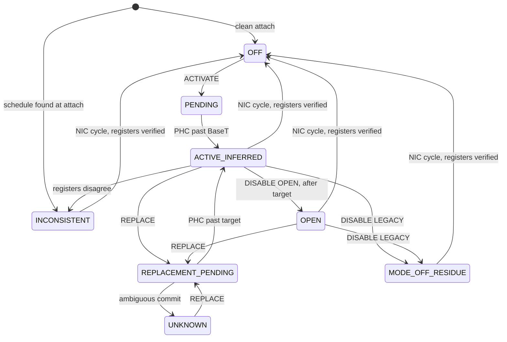

# DES-C-TAS-010: TAS lifecycle IOCTL contract

**Design only.** This document changes no driver code, test, runner entry, existing IOCTL or governance file. Requirement and test identifiers (`TAS-R-nn`, `TC-TASAPI-nnn`, `EG-nn`) are drafts until GitHub issues exist. GitHub Issues remain the lifecycle source of truth.

Tags used throughout:

| Tag | Meaning |
|---|---|
| **HW** | Observed on hardware, with run count |
| **DOC** | Intel I225/I226 software manual, paraphrased |
| **LINUX** | Linux `igc` behaviour. A reference, not a requirement |
| **INFERENCE** | Reasoned from evidence, not directly measured |
| **UNVERIFIED** | No evidence yet |

## 1. Scope and evidence limits

All **HW** evidence comes from one setup, and every statement is limited to it:

| Limit | Value |
|---|---|
| Hardware | One I226-LM, `0x125B`, `REV_04` |
| Driver | Debug, `FB64A0966D836CFB…`, Debug-only register interfaces |
| Evidence class | `LOCAL_DIAGNOSTIC`, not automated HIL |
| Observer | I210 same-host software capture. Supplementary, millisecond resolution |
| Link and load | 1 Gbit/s, low frame rate, one active TX ring (ring 0) |
| Windows | Identical on all four queues in every run |
| Buffers | **Default `TXPBSIZE` (`0x04000014`) and `DTXMXPKTSZ` (`0x98`) in every run**, not the TSN values the manual recommends (see EG-03) |
| PHC | Runs 2.93 % fast, so all times are PHC-domain and not wall-clock |
| First schedule | Always followed the existing `SETUP_TAS`, except one mode-last run |

### Evidence used

Logs are in `C:\Users\User\cqv\i328\evidence\tasarm-20261105`, with full hashes in `SHA256SUMS.txt`. The record is `investigations/issue-328-tas-isolated-arm-20261104.md`.

| ID | Observation | Runs | Evidence |
|---|---|---|---|
| E1 | Windows plus a future `BaseT` replace a running schedule at the intended boundary, no NIC cycle, no `FutScdDis` | 6 of 6 dedicated; 16 of 16 counting all window changes | `90669b29`, `05664aa3`, `6aff008e`, `98c94f7e`, `664d44e3`, `d9ad1e0d`, `1e02a965`, `2a2f4feb` |
| E2 | Same-cycle replacement needs no shadow or cycle write | 1 run | `664d44e3` |
| E3 | A changed cycle applied with shadow, cycle and future `BaseT`; `BaseT` then stepped at the new cycle | 1 run | `98c94f7e` |
| E4 | Routes without a future `BaseT` do not replace: windows alone, plus shadow and cycle, past `BaseT`, windows written at `TQAVCTRL=0` | 0 of 6 | `26c4f42e`, `94b0b522`, `d93dbddb`, `def48094`, `0de0d3b4` |
| E5 | Register reads cannot separate pending from active. On a running schedule `BASET_H` keeps showing the old value | Every run | as E1 |
| E6 | `FutScdDis` set: held frames release around programming and traffic flows until `BaseT`, then gating. Clear: frames held until the first window after `BaseT`, up to 4.76 s | 2 of 2, 1 of 1 | `dc8cb4b7`, `c84b08c1`, `d7024d5c` |
| E7 | `TXQCTL.Strict_End` takes effect by the next window; windows wait for `BaseT` | 3 of 3 runs, both directions | `2a2f4feb`, `d9ad1e0d`, `1e02a965` |
| E8 | `Strict_End` holds a frame that cannot fit and blocks the whole queue behind it; fitting frames pass | 2 of 2 valid runs | `d9ad1e0d`, `1e02a965` |
| E9 | `TQAVCTRL` 9→0→9 passes frames at 0 and resumes the same schedule | 1 run | `305a5ef3` |
| E10 | In-place disarm: frames pass, windows, shadow, cycle and mode can be written back, `BaseT` writes are ignored and it keeps advancing | 1 run, plus 3 cycles | `c4009a76`, `1f355629` |
| E11 | PHC shows no step across schedule writes, replacements or `TQAVCTRL` changes | Every run | as E1, E9, E10 |
| E12 | A NIC cycle resets the PHC. Driver `init_ptp` reseeds `SYSTIM` | Every cycle | Issue 8 draft |
| E13 | A NIC cycle clears schedule registers | 40 of 41 comparisons | Register logs |
| E14 | One cycle left the full schedule with `tasArmed=0`. TX was held about 11 minutes until the PHC reached the surviving `BaseT`. `Disable-NetAdapter` then recovered it | 1 case, 1 recovery | `d9ad1e0d`, `949a8c0d`, `558451d5`, `c9f1d2f7` |
| E15 | Whole-cycle windows by future `BaseT` pass frames at low rate and a later replacement re-arms | 1 run | `6aff008e` |
| E16 | Periodic gating at 1 s and 125 ms | Repeated at 1 s, 1 run at 125 ms | `b9febbc0` |

**The #328 unload hang remains unexplained.** Nothing here shows a link to it.

### Where the Strict_End evidence sits outside the manual

**DOC** section 8.12.12 sets a minimum window: larger than the transmission time of the greater of 512 bytes and the queue's maximum expected packet, plus 10 %. The 400 ns run and the 5 µs large-frame stages were below that minimum. They remain valid observations of what the hardware did, but they are not a supported configuration. This contract rejects such windows (TAS-R-05).

## 2. Conflicts with existing requirements

Issue `#50` is open and its text differs from the evidence. It is not modified here. **Each row needs Q's decision before implementation.** Local documents also describe `#41` as a TAS gate requirement, but the issue is `REQ-F-PTP-EPOCH-001`, and both `#9` and `#50` carry the ID REQ-F-TAS-001.

| `#50` says | Evidence | Proposal |
|---|---|---|
| Up to 256 gate entries, called a hardware limit | One `STQT`/`ENDQT` pair per queue. **DOC**, **LINUX**: one open period per queue per cycle | One window per queue per cycle |
| `BaseTime` at least PHC + 1 ms | Lowest margin seen working is 0.935 s (UNVERIFIED below that) | Provisional margin 1 s until EG-01 |
| Reconfiguration requires disabling TAS first | **HW** E1 replaces without disable | Separate replace operation |
| Write `BASET` first, enable last | Writing `BaseT` without cycle registers has no defined effect. **DOC** sets shadow, cycle, then `BaseT` | Order in section 5 |
| All-or-nothing atomic configuration | Registers are written one at a time; `TQAVCTRL` and `TXQCTL` act at once | Atomicity comes from the future `BaseT` commit |
| Output buffer: none | Callers need generation and commit time | Fixed in/out struct |
| Event IDs 3003, 9003, 3004 | Not in this contract | Keep as implementation detail, to be decided |

## 3. Operations and state model

### 3.1 Operations

Existing IOCTLs 26, 65 and 66 and their structures stay unchanged. New function codes 71 to 74 are free. All four are `METHOD_BUFFERED`, versioned, fixed-size, and **bound handles only**: an unbound handle fails with `STATUS_INVALID_DEVICE_STATE` and never reaches the fallback adapter search, matching `QUERY_HW_SNAPSHOT`. ABI impact is additive.

| Code | Name | Purpose | Mutates |
|---|---|---|---|
| 71 | `IOCTL_AVB_TAS_ACTIVATE` | First schedule on a clean adapter | Yes |
| 72 | `IOCTL_AVB_TAS_REPLACE` | Replace a schedule that this contract activated | Yes |
| 73 | `IOCTL_AVB_TAS_DISABLE` | Open the gates, or leave TSN mode | Yes |
| 74 | `IOCTL_AVB_TAS_QUERY` | Read-only state, limits, registers, last result. Debug and Release | No |

Relationship to the existing IOCTLs: `SETUP_TAS` leaves a known hold state (`TQAVCTRL=9`, cycle only) and stays for existing tests. The new operations refuse to run on that state (`STATE_CONFLICT`), and `QUERY` reports it as `LEGACY_ARMED`. `DISARM_TAS` keeps its current behaviour. `tas_armed` remains the driver's record for those IOCTLs. Migration or deprecation is a later decision.

### 3.2 Proposed structures

For review only; not added to `include/avb_ioctl.h`. Sizes are to be pinned by a `TC-ABI` test at implementation. Times are PHC nanoseconds. Register widths are SSOT-derived at implementation.

```c
#define AVB_TAS_QUEUES 4u

typedef struct AVB_TAS_QUEUE_WINDOW {
    avb_u32 start_ns;         /* relative to BaseT */
    avb_u32 end_ns;           /* relative to BaseT, exclusive */
    avb_u32 max_frame_bytes;  /* largest frame this queue will carry, sizes the minimum window */
    avb_u32 flags;            /* AVB_TAS_Q_STRICT_END, AVB_TAS_Q_STRICT_CYCLE */
} AVB_TAS_QUEUE_WINDOW;                                     /* 16 bytes */

typedef struct AVB_TAS_SCHEDULE {
    avb_u64 base_time_ns;     /* absolute PHC time */
    avb_u32 cycle_ns;
    avb_u32 reserved;         /* must be 0 */
    AVB_TAS_QUEUE_WINDOW queue[AVB_TAS_QUEUES];
} AVB_TAS_SCHEDULE;                                         /* 80 bytes */

/* ACTIVATE and REPLACE */
typedef struct AVB_TAS_OP_REQUEST {
    avb_u32 version;          /* in */
    avb_u32 flags;            /* in: AVB_TAS_F_PASS_BEFORE_BASE, AVB_TAS_F_REQUIRE_VERIFIED */
    avb_u64 net_luid;         /* in: must equal the bound adapter */
    avb_u64 expected_generation; /* in: 0 for ACTIVATE, else from QUERY */
    AVB_TAS_SCHEDULE schedule;   /* in */
    avb_u64 generation;       /* out */
    avb_u64 phc_commit_ns;    /* out: PHC read after the commit write */
    avb_u32 result;           /* out: AVB_TAS_RESULT */
    avb_u32 reserved;
} AVB_TAS_OP_REQUEST;                                       /* 128 bytes */

typedef struct AVB_TAS_DISABLE_REQUEST {
    avb_u32 version;          /* in */
    avb_u32 mode;             /* in: AVB_TAS_DISABLE_OPEN or AVB_TAS_DISABLE_LEGACY */
    avb_u64 net_luid;         /* in */
    avb_u64 expected_generation; /* in */
    avb_u64 base_time_ns;     /* in: commit time, OPEN only */
    avb_u64 generation;       /* out */
    avb_u64 phc_commit_ns;    /* out */
    avb_u32 result;           /* out */
    avb_u32 restoration;      /* out: AVB_TAS_RESTORE_* */
} AVB_TAS_DISABLE_REQUEST;                                  /* 56 bytes */

typedef struct AVB_TAS_REGS {
    avb_u32 tqavctrl, baset_l, baset_h, qbvcyclet, qbvcyclet_s;
    avb_u32 stqt[4], endqt[4], txqctl[4];
    avb_u32 tdh[4], tdt[4];
    avb_u32 txpbsize, dtxmxpktsz;
    avb_u32 read_failed_mask;  /* non-zero: the block is not trustworthy */
} AVB_TAS_REGS;                                             /* 112 bytes */

typedef struct AVB_TAS_QUERY_REQUEST {
    avb_u32 version;          /* in */
    avb_u32 state;            /* out: AVB_TAS_STATE_* */
    avb_u64 net_luid;         /* out */
    avb_u16 vendor_id, device_id, revision_id, reserved0;
    avb_u32 capabilities, verification, inconsistency, restoration;
    avb_u64 context_epoch;    /* changes on each FilterAttach */
    avb_u64 generation;
    avb_u64 phc_before_ns, phc_after_ns;   /* bracket the register reads */
    avb_u32 queues, windows_per_queue, cycle_min_ns, cycle_max_ns;
    avb_u64 min_margin_ns;
    AVB_TAS_SCHEDULE pending; /* valid in PENDING and REPLACEMENT_PENDING */
    AVB_TAS_SCHEDULE active;  /* driver's record of the schedule it believes active */
    AVB_TAS_REGS regs;        /* programmed registers, as read */
    avb_u32 last_op, last_result, last_ntstatus, last_stage;
    avb_u64 last_generation, last_phc_ns;
} AVB_TAS_QUERY_REQUEST;                                    /* 400 bytes */
```

### 3.3 State model

`state` is computed on every `QUERY` and at the start of every mutating operation by reading registers and the PHC, then comparing them with the driver's record. It is never answered from the driver's record alone.

| State | Meaning | Evidence behind it |
|---|---|---|
| `OFF` | TSN mode off, all schedule registers at baseline | Registers |
| `LEGACY_ARMED` | Armed by `SETUP_TAS`, outside this contract | `tas_armed`, registers |
| `PENDING` | First schedule written, PHC before `BaseT` | Registers, PHC |
| `ACTIVE_INFERRED` | PHC past `BaseT` | Time only |
| `REPLACEMENT_PENDING` | New schedule written, PHC before target | Driver record, PHC |
| `OPEN` | TSN mode on, windows cover the cycle | Inferred; **not restored** |
| `MODE_OFF_RESIDUE` | TSN mode off, `BaseT` or other registers non-baseline | Registers |
| `INCONSISTENT` | Driver and hardware disagree; see `inconsistency` | Registers, PHC, driver record |
| `UNKNOWN` | Cannot be determined, for example an unreadable register or an ambiguous commit | None sufficient |



`INCONSISTENT` reasons are a bitmask, because more than one can hold:

| Reason | Trigger | Seen |
|---|---|---|
| `HW_ARMED_NO_RECORD` | TSN mode or schedule registers set, no driver record | E14 |
| `DRIVER_ARMED_HW_OFF` | Record says armed, hardware is not in TSN mode | UNVERIFIED |
| `BASE_FAR_AHEAD` | `BaseT` more than two cycles ahead of the PHC with no pending record | E14 |
| `PHC_RESET` | PHC moved backward since commit | E12 |
| `WINDOW_MISMATCH` | Registers differ from record | UNVERIFIED |
| `TXQCTL_MISMATCH` | Flags differ from record | UNVERIFIED |
| `LINK_SPEED_CHANGED` | A window no longer meets the minimum at the current speed | UNVERIFIED |
| `READ_FAILED` | A register could not be read | UNVERIFIED |

## 4. Input validation

Validation runs before any register write, so a rejected request changes nothing.

| ID | Rule | Basis | Failure |
|---|---|---|---|
| TAS-R-01 | Handle bound; `net_luid` matches; version known; reserved fields 0; buffers exact size | Repo convention | `INVALID_CONFIG` |
| TAS-R-02 | Adapter advertises `INTEL_CAP_TSN_TAS`; device and revision are on the family's allowlist | Verdict contract | `UNSUPPORTED_HARDWARE` or `NOT_IMPLEMENTED` |
| TAS-R-03 | One window per queue. No gate list is accepted | **DOC**, **LINUX** | `INVALID_CONFIG` |
| TAS-R-04 | `cycle_ns` from `cycle_min_ns` to `cycle_max_ns`, on the **DOC** Table 7-63 list. **DOC** floor 31.25 µs, field limit 30 bits. v1 verified set: 125 ms, 500 ms, 1 s | **DOC**, **HW** E16 | `INVALID_CONFIG`; `UNVERIFIED_CONFIG` for a table value outside the verified set |
| TAS-R-05 | `start_ns < end_ns ≤ cycle_ns`. Window ≥ 1.1 × time of max(512 bytes, `max_frame_bytes` + overhead) at current link speed. All arithmetic in 64 bits | **DOC** 8.12.12 | `INVALID_CONFIG` |
| TAS-R-06 | `end_ns < cycle_ns` for active schedules. Gap sized from the largest PHC adjustment per cycle. `end_ns == cycle_ns` is allowed only for `DISABLE OPEN` | **DOC** 7.5.2.9.2, EG-06 | `INVALID_CONFIG` |
| TAS-R-07 | `base_time_ns` nanoseconds part fits 30 bits after split; seconds fit `BASET_H`; no overflow in `base + n × cycle` | **DOC** 8.12.7-8 | `INVALID_CONFIG` |
| TAS-R-08 | ACTIVATE: base at least `min_margin_ns` after a PHC read. REPLACE: the same, and base on the running grid (`running_base + n × running_cycle`) | E1, all evidence on grid | `DEADLINE_TOO_NEAR`, `UNVERIFIED_CONFIG` |
| TAS-R-09 | All four windows identical in v1, because per-queue behaviour is unmeasured | Evidence limit, EG-11 | `UNVERIFIED_CONFIG` |
| TAS-R-10 | `STRICT_END` accepted. Set at ACTIVATE only; REPLACE must keep the same flags, because `TXQCTL` acts before `BaseT` (E7) | E7, E8 | `UNSUPPORTED_COMBINATION` |
| TAS-R-11 | `STRICT_CYCLE` rejected in v1, despite **DOC** recommending it and **LINUX** setting it, until EG-07 | No evidence | `UNVERIFIED_CONFIG` |
| TAS-R-12 | Rejected: cycle extension, launch time on the same queue, preemption together with Qbv in v1 | No evidence | `UNSUPPORTED_COMBINATION` |
| TAS-R-13 | Only one pending commit per adapter | No evidence on overlap | `BUSY` |
| TAS-R-14 | `expected_generation` matches; `context_epoch` unchanged by REPLACE and DISABLE | Protects against a re-attach | `STATE_CONFLICT` |
| TAS-R-15 | Link up, speed known, `hw_state ≥ AVB_HW_PTP_READY` | Existing handler | `NOT_READY` |

Strict_End meaning for callers: **DOC** allows a frame from a flagged queue only if it is expected to finish inside the window. **HW** E8 adds that a non-fitting frame at the head blocks everything behind it until the window or flag changes. `max_frame_bytes` is the caller's promise, and the driver cannot enforce it on filter-passed traffic, so this hazard is documented, not prevented.

## 5. Initial setup: `TAS_ACTIVATE`

Preconditions: state `OFF`, rules above satisfied, and the adapter's registers read baseline. If not, the operation fails with `STATE_CONFLICT` and writes nothing.

| Step | Action | Notes |
|---|---|---|
| 1 | Read PHC, recheck margin | `DEADLINE_TOO_NEAR` writes nothing |
| 2 | Write `STQT`, `ENDQT`, `TXQCTL` per queue | Mode not yet set, so no effect on traffic |
| 3 | Write `TQAVCTRL`: mode, Enhanced QAV (**DOC** bit 3), `FutScdDis` if requested | **Frames may hold from here** |
| 4 | Write `QBVCYCLET_S`, then `QBVCYCLET` | **DOC** explicit order |
| 5 | Read PHC, recheck margin | Time passes between writes |
| 6 | Write `BASET_H`; if `FutScdDis`, `BASET_L = 0`; then `BASET_L` with `Copy_H` and `Auto_Set` clear | Commit point. **LINUX** zero write |
| 7 | Read PHC, classify (section 6.3) | |
| 8 | Read back every written register | `BASET_H` only after step 6: before that it read 0 in all runs |
| 9 | Record generation, state `PENDING` | Never `ACTIVE` here |

**Pre-activation behaviour** is the caller's choice, reported in `QUERY`:

| Choice | Behaviour | Evidence |
|---|---|---|
| Hold (default flag clear) | Frames held until the first window after `BaseT`. Long holds risk software timeouts: **LINUX** rejects this on I225 | 1 run, 4.76 s hold, 0 lost |
| `AVB_TAS_F_PASS_BEFORE_BASE` | `FutScdDis`: traffic flows until `BaseT` | 2 of 2 |

**Recommendation:** use `PASS_BEFORE_BASE` for production callers, as it bounds the hold, and keep Hold as an explicit option. **Documentation limitation:** the held manual lists `TQAVCTRL` bit 7 as Reserved. Its use rests on **LINUX** and on **HW** E6. `FutScdDis` has no role on a running schedule in this contract.

**This exact sequence has never run.** Every future-`BaseT` run began from `SETUP_TAS`, which set mode and a 1 ms cycle first and held frames. EG-02 must prove it before `ACTIVATE` is accepted. The mode-last alternative (windows, shadow, cycle, `BaseT`, then `TQAVCTRL`) gated correctly in 1 run with a past `BaseT` and is the fallback if EG-02 fails.

**Failure and rollback:**

| Failure point | Rollback | Resulting state |
|---|---|---|
| Before step 3 | Rewrite baseline windows and `TXQCTL` | `OFF` |
| Steps 3-5 | `TQAVCTRL` back, cycle and shadow back, windows back (E10) | `OFF` if readback matches |
| Step 6 onward | `BaseT` cannot be cleared in place (E10). Attempt `DISABLE LEGACY` path | `MODE_OFF_RESIDUE`, result `ROLLBACK_PARTIAL` |
| Rollback write fails | Stop | `INCONSISTENT`, result `ROLLBACK_FAILED` |

`tas_armed` semantics are not touched. The new record lives beside it.

## 6. Schedule replacement: `TAS_REPLACE`

Preconditions: state `ACTIVE_INFERRED` or `OPEN`, or `UNKNOWN` to re-establish a known schedule. Generation and epoch match.

### 6.1 Sequences

| Case | Writes, in order | Evidence |
|---|---|---|
| Same cycle | Windows, `BASET_H`, `BASET_L` | 1 run for exactly this; 5+ with shadow and cycle rewritten |
| Changed cycle | Windows, `QBVCYCLET_S`, `QBVCYCLET`, `BASET_H`, `BASET_L` | 1 run |

Windows, shadow and cycle read back as written before they apply, so `QUERY` during `REPLACEMENT_PENDING` shows pending values in `regs` while `active` holds the running schedule. `BASET_H` is excluded from readback verification here, because on a running schedule it shows the running value (E5).

### 6.2 Minimum margin

`min_margin_ns` is a reported limit, not a constant in callers. **Provisional value: 1 s** (UNVERIFIED below the lowest observed 0.935 s), and never less than two running cycles. `#50`'s 1 ms is not supported by any evidence. EG-01 can lower it. A single `BaseT` write took 34 ms once, so a commit guard of at least that is needed and is measured by EG-01.

### 6.3 Commit classification

The driver reads the PHC immediately before (`t0`) and after (`t1`) the `BASET_L` write. Guard is `AVB_TAS_COMMIT_GUARD_NS`.

| Condition | Conclusion | Action |
|---|---|---|
| `t1 + guard < target` | Written in time | `REPLACEMENT_PENDING` |
| `t0 ≥ target` | Write landed after the target. Old schedule continues (E4, 1 run) | Rewrite previous windows, `DEADLINE_MISSED`, previous state |
| Otherwise | Cannot tell | `UNKNOWN`, `ACTIVATION_AMBIGUOUS`. Do not rewrite windows |

A missed deadline is a **failure**, and must never be masked by the windows reading back as new, because that is exactly the silent case in E4. Whether a past `BaseT` is also harmless when the cycle changed is UNVERIFIED (EG-15), so a changed-cycle miss reports `UNKNOWN`. Recovery from `UNKNOWN` is a new `REPLACE` with a future target, which re-establishes a known schedule.

### 6.4 Partial writes

Writes before the commit do not take effect on a running schedule (E4), so a failure before `BASET_L` is recovered by rewriting previous values. If that readback fails: `INCONSISTENT`, `ROLLBACK_FAILED`. The running schedule is still the old one by inference.

## 7. Disable and restoration: `TAS_DISABLE`

### 7.1 Hardware and driver state are separate

The driver record and hardware can differ, as E14 showed. Success of this operation is judged from registers and the PHC, not from the record. `restoration` reports the outcome:

| Value | Meaning |
|---|---|
| `AVB_TAS_RESTORE_COMPLETE` | All schedule registers at baseline, TSN mode off |
| `AVB_TAS_RESTORE_PARTIAL_OPEN` | Gates open, TSN mode on |
| `AVB_TAS_RESTORE_PARTIAL_RESIDUE` | TSN mode off, residue such as a live `BaseT` |
| `AVB_TAS_RESTORE_NONE` | Schedule still gating |
| `AVB_TAS_RESTORE_UNKNOWN` | Not determinable |

### 7.2 Options

| Option | Effect | PHC | Evidence | Restoration |
|---|---|---|---|---|
| `OPEN` | Whole-cycle windows by future `BaseT`. TSN mode stays. Applies up to the margin later | Continuous | 1 run, low rate | `PARTIAL_OPEN` |
| `LEGACY` | `TQAVCTRL` mode cleared, then windows, shadow and cycle written back. Frames pass immediately | Continuous | 1 run plus 3 cycles | `PARTIAL_RESIDUE`: `BaseT` keeps advancing |
| NIC cycle | Owned by the test or operator, **never by the driver**. A filter has no documented way to reset the miniport | **Reset** (E12) | 40 of 41 | `COMPLETE` only after registers are read |

`LEGACY` conflicts with guidance: **DOC** 7.5.2.1 says transmit mode is set at initialisation and not during operation, **LINUX** resets the adapter here, and the source comment on `disable_tas` notes that the miniport owns `TQAVCTRL`. So it is opt-in, and **`OPEN` is the recommended disable**. This is a decision for Q (section 12). Until EG-14, `ACTIVATE` after `LEGACY` is refused with `STATE_CONFLICT`, as re-arming from that state by future `BaseT` has not been run.

Legacy-mode behaviour: frames pass with no gating and the windows are ignored, yet a later `TQAVCTRL` write resumes the same schedule (E9), so leaving TSN mode does not erase it.

**Baseline** is a family constant from the SSOT, not a value captured at attach, because E14 shows attach can see a dirty adapter. Note that **HW** read `ENDQT` as 0 at baseline where **DOC** lists a 1 s default. The family table has to accept what the hardware shows, and this is recorded as a difference from the manual.

A NIC cycle must be followed by a register read before anyone calls the adapter restored. PHC reset is reported separately, so "registers restored, PHC reset" stays visible, as with today's exit 2.

Behaviour at detach and unload with a live schedule is UNVERIFIED (EG-13). This contract adds none. Its relation to #328 is unproven.

## 8. State reporting

`QUERY` separates four things that must never be merged:

| Field | Meaning | Source |
|---|---|---|
| `regs` | **Programmed**: register values now | Hardware read |
| `pending` | **Pending**: written, target not reached | Driver record, PHC |
| `active` with `verification = INFERRED_TIME` | **Inferred active**: PHC has passed the target | Driver record, PHC |
| `verification = HW_VERIFIED` | **Hardware-verified active** | A validated mechanism only |
| `state = INCONSISTENT` or `UNKNOWN` | Disagreement or indeterminate | Reconciliation |

| `verification` | Meaning | v1 |
|---|---|---|
| `NONE` | No schedule, or nothing supports a claim | Returned |
| `INFERRED_TIME` | PHC past target and registers match the record | Returned |
| `HW_VERIFIED` | A hardware signal confirms the new schedule | **Never returned in v1**: no validated mechanism exists |

Write success, readback match and PHC passing `BaseT` never produce `HW_VERIFIED`. Wire proof stays in the test: an external observer attests behaviour, and the driver does not report it. Candidates for a mechanism are in EG-05.

The driver reports no gate-edge accuracy figure.

## 9. Error semantics

Under the repository's `METHOD_BUFFERED` caveat, an error completion does not return the output buffer. So **every operation stores its result, stage and NTSTATUS in the adapter context**, returned by `QUERY` in `last_*`. Test verdicts capture the raw NTSTATUS, per `tests/common/avb_verdict.h`.

| Result | NTSTATUS | State after | Verdict if unexpected |
|---|---|---|---|
| `OK_PENDING` | `STATUS_SUCCESS` | Pending | n/a |
| `INVALID_CONFIG` | `STATUS_INVALID_PARAMETER` | Unchanged, nothing written | `FAIL` |
| `UNSUPPORTED_HARDWARE` | `STATUS_NOT_SUPPORTED`, only if the capability is absent | Unchanged | `SKIP_UNSUPPORTED` |
| `NOT_IMPLEMENTED` | `STATUS_NOT_IMPLEMENTED`: capable family, operation missing | Unchanged | `SKIP_NOT_IMPLEMENTED` |
| `UNVERIFIED_CONFIG` | `STATUS_NOT_IMPLEMENTED`: valid request, evidence not yet available. **Never reported as missing hardware** | Unchanged | `SKIP_NOT_IMPLEMENTED` |
| `UNSUPPORTED_COMBINATION` | `STATUS_INVALID_PARAMETER` | Unchanged | `FAIL` |
| `NOT_READY` | `STATUS_DEVICE_NOT_READY` | Unchanged | `BLOCKED` |
| `BUSY` | `STATUS_DEVICE_BUSY` | Unchanged | `BLOCKED` |
| `STATE_CONFLICT` | `STATUS_INVALID_DEVICE_STATE` | Unchanged | `BLOCKED` |
| `DEADLINE_TOO_NEAR` | `STATUS_INVALID_PARAMETER` | Unchanged | `FAIL` |
| `DEADLINE_MISSED` | `STATUS_IO_TIMEOUT` (not the success-class `STATUS_TIMEOUT`) | Old schedule, windows rewritten | `FAIL` |
| `ACTIVATION_AMBIGUOUS` | `STATUS_IO_TIMEOUT` | `UNKNOWN` | `FAIL` |
| `READBACK_MISMATCH` | `STATUS_DEVICE_DATA_ERROR` | Rolled back or `INCONSISTENT` | `FAIL` |
| `MMIO_FAILED` | `STATUS_IO_DEVICE_ERROR` | Rolled back or `INCONSISTENT` | `FAIL` |
| `ROLLBACK_PARTIAL` | `STATUS_UNSUCCESSFUL` | `MODE_OFF_RESIDUE` | `CLEANUP_FAILED` in cleanup, else `FAIL` |
| `ROLLBACK_FAILED` | `STATUS_UNSUCCESSFUL` | `INCONSISTENT` | `CLEANUP_FAILED` in cleanup, else `FAIL` |
| `INCONSISTENT_STATE` | `STATUS_INVALID_DEVICE_STATE` | `INCONSISTENT`, nothing written | `FAIL` |
| `RESTORATION_INCOMPLETE` | `STATUS_UNSUCCESSFUL`, with `restoration` in `QUERY` | As reported | `CLEANUP_FAILED` |
| `UNVERIFIABLE` | `STATUS_NOT_IMPLEMENTED`: `AVB_TAS_F_REQUIRE_VERIFIED` asked for what no mechanism provides. Refused before any write | Unchanged | `SKIP_NOT_IMPLEMENTED` |

`DISABLE` returning `OPEN` or `LEGACY` is a success with `restoration` set to a partial value: the requested operation worked, and the partial result is stated, not hidden. A caller wanting complete restoration must read `QUERY` after a NIC cycle.

## 10. Responsibilities

| Concern | Driver | Test | Operator or runner |
|---|---|---|---|
| Validating requests | Owns | Exercises | |
| Programming and rollback | Owns | | |
| Reporting state honestly | Owns | Reads | |
| Proving pre-state | Reports through `QUERY` | Owns: every test proves its own prerequisites | |
| Traffic and wire observation | | Owns, using the I210 observer | |
| Cleanup and NIC cycle | Does not cycle the NIC | Owns | Runner keeps Safety, gap and timeout rows |
| Restoration verdict | | Owns: `QUERY`, PHC, TX on the wire | |
| `CLEANUP_FAILED` | | Reports. It never blocks later tests | Stays visible |
| Reboot | | | Operator decision only |
| Recording surviving state | Reports `INCONSISTENT` | Reports; no automatic fix | |

## 11. Release observability

**Need:** in Release, with no `READ_REGISTER` or `WRITE_REGISTER`, a test must see TSN mode, cycle, `BaseT`, windows, flags, ring pointers and the PHC, atomically enough to reconcile them.

| Option | Assessment |
|---|---|
| Extend `QUERY_HW_SNAPSHOT` | **Rejected.** 280 bytes pinned by `TC-ABI-022` and hard-coded in `Run-Tests-CI.ps1`, and it would grow a family-independent table with TSN-only registers. Has only `TQAVCTRL` |
| New snapshot version | **Rejected.** Same callers, and it would still leave state interpretation to every test |
| Extend `GET_TAS_STATE` | **Rejected.** Changes an existing ABI, and it is documented as driver-level state only |
| Allow `READ_REGISTER` in Release | **Rejected.** Generic, and disabled for security. Generic `WRITE_REGISTER` stays Debug-only |
| **`IOCTL_AVB_TAS_QUERY`** | **Proposed.** One purpose, fixed register set, no caller-supplied offsets, read-only, bound handles only, Debug and Release |

Register offsets come from `intel-ethernet-regs` through a new device op, not literals. Nothing in the set has a read side effect; `TXSTMP` registers are excluded because reading them changes state. `revision_id` needs to reach `QUERY`, and implementation must confirm how the driver obtains it.

Also needed, already available in Release: `GET_STATISTICS` (outstanding sends), `GET_CLOCK_CONFIG` (PHC), the I210 observer. **No raw write is exposed.** Automated HIL uses `ACTIVATE`, `REPLACE`, `DISABLE` and `QUERY` only.

## 12. Decisions for Q

| # | Decision | Recommendation |
|---|---|---|
| D1 | Update `#50`, or file a new requirement replacing it | New REQ issues tracing to `#50`, then update `#50` |
| D2 | Default disable | `OPEN` as default, `LEGACY` opt-in |
| D3 | Default pre-activation behaviour | `PASS_BEFORE_BASE` for production callers |
| D4 | Accept a v1 restricted to identical windows and three cycles | Yes, widen by evidence |
| D5 | Packet-buffer configuration (EG-03) | Decide after EG-03. A filter cannot reset the miniport to change it |
| D6 | Whether an architecture decision issue is needed | Yes: ADR for filter-side TSN ownership |

## 13. Evidence gaps

Priority order. **Blocks** names only the operation or claim affected. Everything else proceeds.

| ID, priority | Requirement | Existing | Missing | Experiment | Expected | Acceptance | Blocks |
|---|---|---|---|---|---|---|---|
| EG-02, P1 | ACTIVATE sequence (section 5) | Future base always after `SETUP_TAS` | The exact order from a clean adapter | Diagnostic: section 5 order, both `FutScdDis` choices | Clear: held to first window after `BaseT`. Set: pass, then gated | 3 runs each, 0 lost, 0 outside window after `BaseT`, restoration clean | **ACTIVATE** |
| EG-03, P1 | Buffer configuration in TSN mode | Default `TXPBSIZE` and `DTXMXPKTSZ` throughout. **DOC** and **LINUX** set 5 KB per queue and 1600 bytes | Whether default values are safe, and whether a filter can change them | Read `QUERY` under stress at MTU; review miniport ownership before any write | No stall or loss at sustained rate with default values, or a documented failure | Decision D5 with data | Production claim, not diagnostics |
| EG-09, P1 | Release verification | Debug only. Release driver never ran these routes | Same behaviour in Release | Run all TC-TASAPI in Release after implementation | Same verdicts | Debug and Release GREEN with installed SHA256 | **Contract acceptance** |
| EG-04, P1 | Schedule state after NIC cycle | 40 of 41 clean, 1 survival, 1 recovery by `Disable-NetAdapter` | Trigger, and whether recovery always works | See defect draft. Instrument only; do not chase without a trigger hypothesis | Rare reproduction with timeline, or a found trigger | Trigger or bound; recovery shown at least 3 times | `RESTORE_COMPLETE` guarantee only. Reporting already covers it |
| EG-01, P2 | Minimum `BaseT` margin | Lowest 0.935 s; one write 34 ms | Any lower value | Step margin 500, 200, 100, 50 ms, each 10 replacements, on a 1 s cycle | Replacement at the target down to a limit, then silent no-change | 10 of 10 at chosen margin, plus guard | Margins below 1 s only |
| EG-05, P2 | Activation proof | Only the wire proves it. `TEST_SEND_PTP` timestamps are pre-send, so they prove nothing about egress | A hardware signal | (a) Hardware TX timestamp of a kernel-sent frame, against window. (b) Commit `BaseT` off the old grid and read whether the register adopts the new grid after the target | (a) Timestamp inside the window. (b) Grid changes only when the schedule did | Agrees with the I210 in 20 of 20, including a deliberately missed commit | `HW_VERIFIED` only. `INFERRED_TIME` proceeds |
| EG-06, P2 | Frame crossing the cycle end | Whole-cycle windows at low rate; **LINUX** cites an I225/I226 specification update item on crossing windows, using `RETX_CTL` | Behaviour at load; whether `RETX_CTL` is needed | Sustained MTU frames with `end == cycle` and with a gap | No loss or stall with the chosen gap | 0 lost, TDH keeps moving, 10 minutes | `DISABLE OPEN` at load; gap value |
| EG-07, P2 | `Strict_Cycle` | None | Effect | Matrix with windows that respect TAS-R-05, flag set and clear, frame at cycle end | Frame finishing past the cycle end held | 2 runs with fitting controls passing | Acceptance of `STRICT_CYCLE` only |
| EG-08, P2 | Short-cycle accuracy | 125 ms, ±30 ms host uncertainty | Accuracy, and cycles below 125 ms | Hardware RX timestamps on the I210, with PHC correlation | Arrivals within window, uncertainty below 10 % of window | Stated uncertainty; 0 outside window | Cycles below 125 ms; any accuracy claim |
| EG-10, P2 | Additional hardware | `REV_04` only | I226-V, I226-IT, other steppings, I225 | Repeat EG-02 and the replace tests on each | Same, or a recorded difference | Per-device GREEN | Allowlist entries only |
| EG-11, P3 | Per-queue windows | Identical windows; only ring 0 carries traffic | Independence | Needs traffic on a second ring; feasibility unknown | Queues gate separately | 2 runs | Non-identical windows only |
| EG-12, P3 | Link and power events | None on a live schedule | Link flap, speed change, miniport reset, S3 | Each event with a live schedule, then `QUERY` and wire | Report matches hardware | Each event classified | Nothing. Reconciliation reports what it finds |
| EG-13, P3 | Detach and unload with a live schedule | Source comment only. Link to #328 unproven | What happens | Under a Scenario B test plan, not here | Characterised | Recorded outcome | Unload guarantee only |
| EG-14, P3 | Re-arm after `LEGACY` | Past-`BaseT` re-arm kept the old schedule | Future `BaseT` after mode off | `LEGACY`, then future `BaseT`, then `TQAVCTRL` | New schedule applies | 2 runs | `ACTIVATE` from `MODE_OFF_RESIDUE` |
| EG-15, P3 | Overlapping and off-grid commits; changed-cycle miss | None | Effects | Each case separately | Characterised | Recorded outcome | Those rejected cases only |
| EG-16, P3 | Repeat of 1-run results: E2, E3, E9, E15 | 1 run each | Repeatability | Covered by the TC-TASAPI tests | Same | GREEN | Nothing beyond those tests |

## 14. Requirement-to-HIL traceability

All tests are **hardware** tests using dedicated IOCTLs only, with no `READ_REGISTER` or `WRITE_REGISTER`. Each discovers capability, proves its pre-state with `QUERY`, owns its setup and NIC-cycle cleanup, and proves restoration by `QUERY`, measured PHC and TX on the wire. Verdicts follow `docs/testing/test-verdict-contract.md`. They reuse `tests/hardware/tas_wire_observer.h`, and the runner rows and coverage-gap entries are added at implementation. No new harness is proposed. **RED evidence** is the listed `LOCAL_DIAGNOSTIC` record plus the test failing against the unimplemented IOCTL. A mock or offline test is supplementary and cannot establish HIL GREEN.

| Test | Operation | Requirements | Hardware behaviour proved | RED | Debug | Release |
|---|---|---|---|---|---|---|
| TC-TASAPI-001 | QUERY | Section 8, 11 | Clean adapter reads `OFF`, values agree with hardware state, read-only | Not implemented | Yes | Yes |
| TC-TASAPI-002 | All | TAS-R-01, 02 | Non-TAS adapter: `SKIP_UNSUPPORTED`. Unbound handle refused | Not implemented | Yes | Yes |
| TC-TASAPI-003 | ACTIVATE, REPLACE | TAS-R-03 to 15 | Each invalid request refused, `QUERY` and TX unchanged | Not implemented | Yes | Yes |
| TC-TASAPI-004 | ACTIVATE, hold | Section 5 | Frames held until first window after `BaseT`, then gated; `PENDING` then `ACTIVE_INFERRED` | E6, EG-02 | Yes | Yes |
| TC-TASAPI-005 | ACTIVATE, pass | Section 5 | Frames flow until `BaseT`, then gated | E6, EG-02 | Yes | Yes |
| TC-TASAPI-006 | REPLACE, same cycle | Section 6 | Wire moves at target, not before; registers alone do not claim it | E1, E2 | Yes | Yes |
| TC-TASAPI-007 | REPLACE, changed cycle | Section 6 | New cycle on the wire at target | E3 | Yes | Yes |
| TC-TASAPI-008 | REPLACE, too near | TAS-R-08 | Refused, schedule unchanged on the wire | E4 | Yes | Yes |
| TC-TASAPI-009 | ACTIVATE, Strict_End | TAS-R-05, 10 | Fitting frame passes. Frame above declared `max_frame_bytes` held, released on a wider window | E8 | Yes | Yes |
| TC-TASAPI-010 | DISABLE OPEN | Section 7 | Flat arrivals, no step in PHC, `PARTIAL_OPEN` reported, later REPLACE re-gates | E15 | Yes | Yes |
| TC-TASAPI-011 | DISABLE LEGACY | Section 7 | Frames pass at once, PHC continuous, `PARTIAL_RESIDUE` reported | E10 | Yes | Yes |
| TC-TASAPI-012 | Restoration | Section 7 | After NIC cycle: `OFF`, `COMPLETE`, TX on the wire, PHC reset reported | E13 | Yes | Yes |
| TC-TASAPI-013 | Interplay | Section 3.1 | After `SETUP_TAS`: `LEGACY_ARMED`, new operations refused | Not implemented | Yes | Yes |

**Cannot be driven on hardware by dedicated IOCTLs, so these stay mock or offline until a real trigger exists, and are marked UNVERIFIED:** `READBACK_MISMATCH`, `MMIO_FAILED`, `ROLLBACK_*`, the race in `ACTIVATION_AMBIGUOUS`, and `HW_ARMED_NO_RECORD`. Mocks for these must reproduce E14's recorded register values, and they must not be presented as HIL verification. The `HW_ARMED_NO_RECORD` path gets HIL evidence only if EG-04 finds a trigger.

TAS tests here are mutating, so they carry the existing Safety classification and authorization. Nothing here adds a gate or global blocking.

## 15. Not in this design

Production code, new header entries, test files, runner changes, Debug diagnostics in automated tests, a fix for the surviving schedule, PHC reseed or TIMINCA fixes (Issue 8, Issue 15), and any statement about the #328 unload hang.
